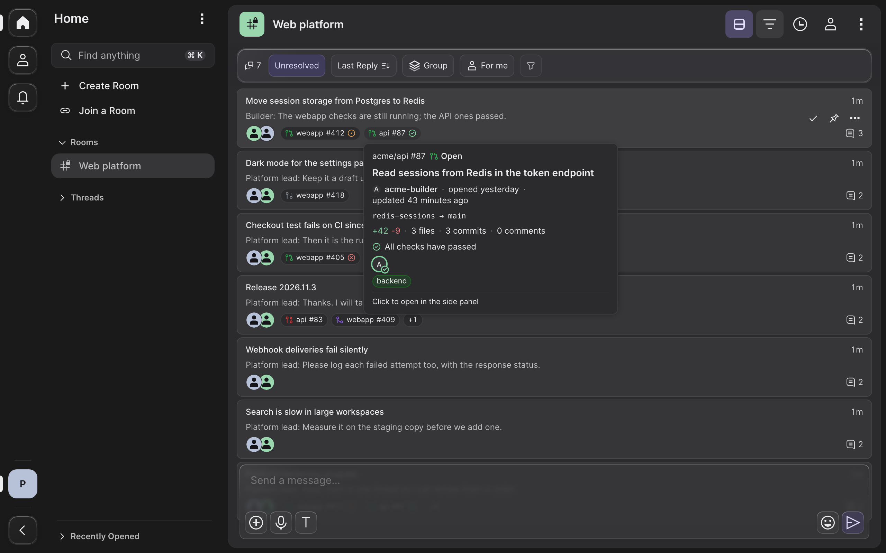
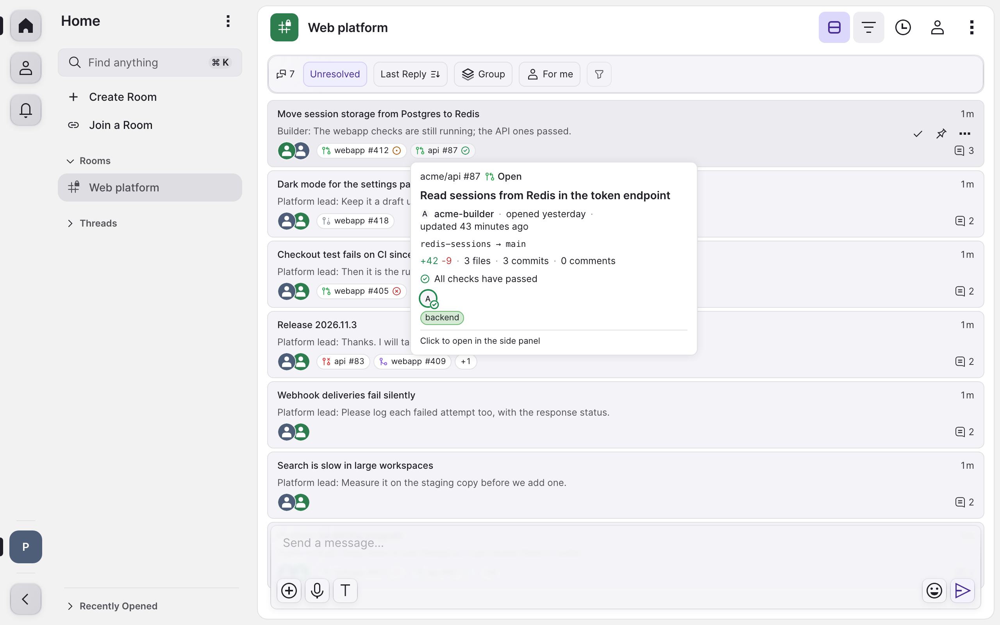
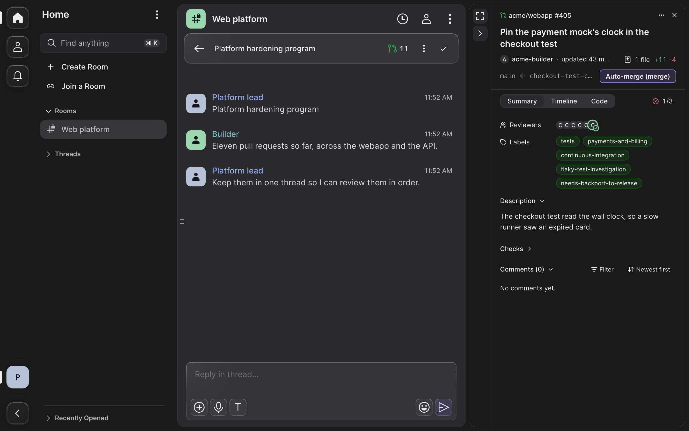
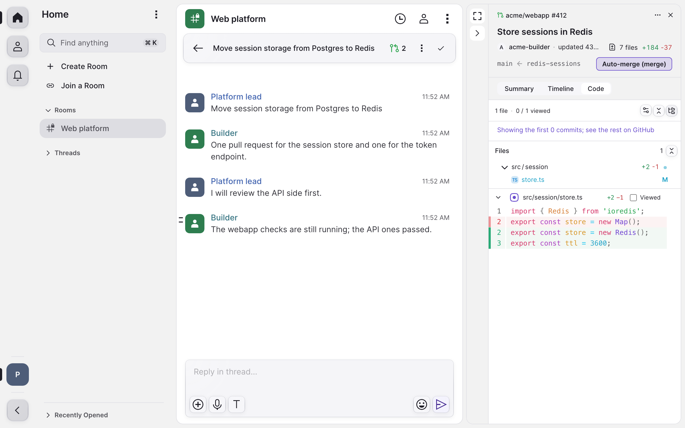
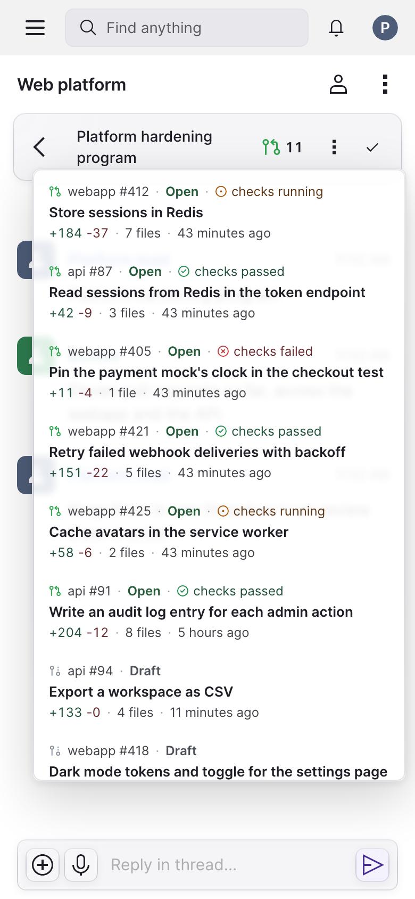
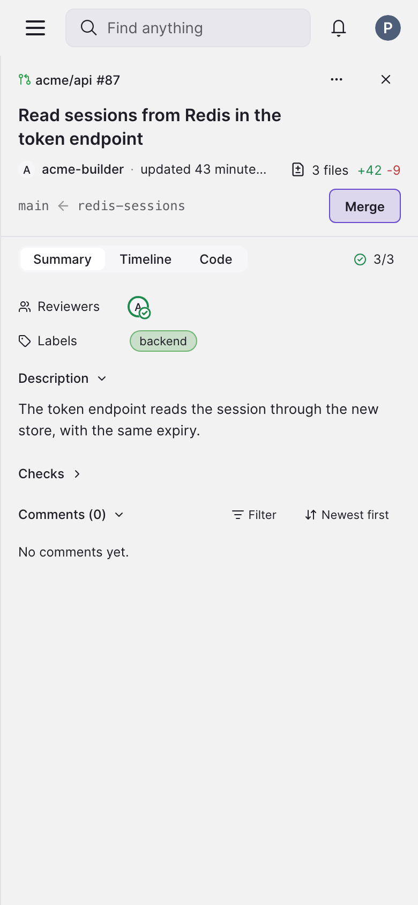

# Pull Requests

[](LICENSE)
[](https://github.com/mindroom-ai/pull-request-client-plugin/actions/workflows/ci.yml)
[](https://github.com/mindroom-ai/mindroom-chat/blob/main/docs/client-plugins.md)

<picture>
  <source media="(prefers-reduced-motion: no-preference)" srcset="https://raw.githubusercontent.com/mindroom-ai/mindroom/main/assets/logo/logo-mark-animated.svg" />
  
</picture>

A [MindRoom Chat](https://github.com/mindroom-ai/mindroom-chat) client plugin that brings GitHub pull requests and git worktree branches directly into rooms — with status chips on Compact thread cards, rich hover and thread-detail previews, a thread header PR menu, and an in-room side panel for reviewing summaries, timelines, changed files, syntax-highlighted diffs, and merge actions.

Click any pull request link or chip to open it beside the conversation (click again while it is open to jump to GitHub). The pull request card and diff viewer are adapted from [T3 Code](https://github.com/pingdotgg/t3code) (MIT, see [NOTICE](NOTICE)).

## Screenshots

| Compact cards & hover preview (dark)                                                | Compact cards & hover preview (light)                                                 |
| ----------------------------------------------------------------------------------- | ------------------------------------------------------------------------------------- |
|  |  |

| Side panel — Summary & actions (dark)                                              | Side panel — File tree & Code diff (light)                                          |
| ---------------------------------------------------------------------------------- | ----------------------------------------------------------------------------------- |
|  |  |

| Phone 390px — Thread PR menu                                    | Phone 390px — PR side panel                              |
| --------------------------------------------------------------- | -------------------------------------------------------- |
|  |  |

## Why it's useful

- **PR status & worktree branches at a glance:** Compact thread cards display linked PRs with GitHub's native state colors (open, draft, merged, closed) and CI check marks, or the thread's git worktree branch when no PR is linked yet.
- **Rich hover & thread details:** Hover any PR chip or link for an instant preview card (reviewers, labels, checks, branch status, diff stats), or open the thread header PR menu to browse every linked PR.
- **Review diffs without leaving chat:** The in-room side panel includes **Summary**, **Timeline**, and **Code** tabs with a resizable file tree, split or stacked syntax-highlighted diffs, inline review threads, commit selector, and per-file viewed marks.
- **Merge, update, and manage PRs in place:** Maintainers with write access can merge (merge, squash, or rebase), toggle auto-merge, update branches behind base, mark drafts ready, close or reopen PRs, and safely delete merged branches right from the panel.
- **Flexible GitHub authentication:** Public repos work read-only out of the box; private repos and write actions work seamlessly through MindRoom's GitHub connection or a personal access token stored in the browser.

## Quick start

### Bundled by default

Official MindRoom Chat builds (web, Mac, iOS, and Docker) already bundle `pull-request-client-plugin` out of the box.

- **Per-user toggle:** Enable or disable the plugin in **Settings → Plugins** (synced across devices).
- **Deployment override:** Disable it across a deployment in MindRoom Chat's `config.json`:

```json
{
  "plugins": {
    "pull-requests": {
      "enabled": false
    }
  }
}
```

### Companion backend plugins

Pair this client plugin with MindRoom's backend plugins to populate thread cards and menus automatically:

- [`pull-request-plugin`](https://github.com/mindroom-ai/pull-request-plugin) — links pull requests agents create to Matrix threads.
- [`thread-worktree-plugin`](https://github.com/mindroom-ai/thread-worktree-plugin) — ties each Matrix thread to its active git worktree so branch chips appear on cards and in menus.

### Custom builds & Docker

To build MindRoom Chat with a local checkout of this plugin, install dependencies here once (`.npmrc` sets `legacy-peer-deps` so `@pierre/*` shares the client's React) and pass its absolute path via `MINDROOM_CLIENT_PLUGINS` (see [`docs/client-plugins.md`](https://github.com/mindroom-ai/mindroom-chat/blob/main/docs/client-plugins.md)). Requires MindRoom Chat client SDK `66` or later:

```bash
git clone https://github.com/mindroom-ai/pull-request-client-plugin.git
cd pull-request-client-plugin
npm ci

cd /path/to/mindroom-chat
MINDROOM_CLIENT_PLUGINS=/abs/path/to/pull-request-client-plugin npx vite build
```

For Docker builds, copy the plugin into your build context and pass `--build-arg`:

```bash
docker build -f docker/Dockerfile \
  --build-arg MINDROOM_CLIENT_PLUGINS=/src/plugins/pull-request-client-plugin \
  -t mindroom-chat .
```

## Connecting GitHub

- **Public repositories (no auth):** Read-only views work immediately without a token (subject to GitHub's 60 req/hr unauthenticated limit).
- **MindRoom GitHub connection (recommended):** In rooms backed by a MindRoom server, connect GitHub in MindRoom via the GitHub App or save a token in MindRoom (`Save in MindRoom at <host>` in the panel's token form) so every device shares access without storing tokens in the browser.
- **Browser personal access token:** Enter a GitHub token in the PR panel to store it in `localStorage` for the signed-in account on that browser (overrides MindRoom's connection while set).

### Fine-grained PAT permissions

Every fine-grained token automatically includes **Metadata: Read**. Grant these repository permissions:

| Permission      | Read-only access                                                                                                                         | Write actions (optional)                                                 |
| --------------- | ---------------------------------------------------------------------------------------------------------------------------------------- | ------------------------------------------------------------------------ |
| Pull requests   | **Read** — PR metadata, files, commits, reviews, review comments, and conversation comments (`GET /pulls/{n}/*`, `/issues/{n}/comments`) | **Read & write** — merge, auto-merge, draft/ready, close, reopen, update |
| Contents        | **Read** — per-commit files, behind-base comparison, and blobs (`GET /commits/{ref}`, `/compare/{basehead}`, `/git/blobs/{sha}`)         | **Read & write** — merge, update branch, delete merged branch            |
| Commit statuses | **Read** — head commit statuses (`GET /commits/{ref}/status`)                                                                            | —                                                                        |

> **Note on check runs:** GitHub does not offer a fine-grained PAT permission for `/commits/{ref}/check-runs` (GitHub Actions). Fine-grained tokens show commit statuses only; MindRoom's GitHub App (**Checks: Read**) or a classic PAT (no scope for public repos, `repo` scope for private repos) shows check runs too.

<details>
<summary><b>Pull request actions &amp; merge rules</b></summary>

- **Primary header action (write access required):** Shows **Merge** (Merge, Squash and merge, or Rebase and merge), **Auto-merge** when checks are pending/failing and the repo allows auto-merge while GitHub would not merge immediately, **Ready for review** for drafts, or a **Conflicts** badge when conflicting. While GitHub computes mergeability (`mergeable: null`), the button shows `Checking whether it can merge...` and re-polls after 1 s, 2 s, and 4 s.
- **More actions menu:** Holds **Open on GitHub**, **Copy checkout command** (`gh pr checkout`), merge method selection (remembered per account), **Merge now**, **Enable/Disable auto-merge**, **Ready for review / Convert to draft**, **Close / Reopen pull request**, **Delete branch**, **Refresh**, and token controls.
- **Updating branches:** When a mergeable branch is behind base, the base-branch warning offers **Update branch** (merge) and **Update with rebase**.
- **Safety confirmations:** **Merge**, **Merge now**, **Auto-merge**, and **Close** require a second confirmation click within 3 seconds (`Confirm merge?`, etc.; Escape or blur disarms). **Delete branch** only appears for merged or closed same-repo non-default branches still at the PR's head SHA, asks in a dialog, and enforces `beforeOid` so concurrent pushes are never lost.
- **Execution &amp; refresh:** One action runs at a time per PR; Merge, Auto-merge, and Update pass the displayed head SHA so stale requests fail safely. After every action, the panel fetches fresh PR state and reports outcomes or GitHub's refusal reason in a status line beneath the header.

</details>

<details>
<summary><b>Thread chips, worktrees &amp; Matrix state</b></summary>

- **Linked pull requests (`com.mindroom.thread.pull_request`):** Written by [`pull-request-plugin`](https://github.com/mindroom-ai/pull-request-plugin) into room state with compact JSON key `["<thread_root_event_id>","<owner>/<repo>#<number>"]` (lowercased) and content `{"url","set_by","set_at"}` (`{}` when unlinked).
- **Compact card chips:** Show up to 2 PR chips on desktop (1 on phone) plus `+N`, sorted open-first once summaries load (prefixing repo names when links span multiple repos). On fine-pointer devices, hovering a chip or message PR link for 150 ms opens a read-only preview card; clicking opens the side panel (on phone, tapping a message link opens an inline card first).
- **Thread worktrees (`com.mindroom.thread.worktree`):** Written by [`thread-worktree-plugin`](https://github.com/mindroom-ai/thread-worktree-plugin) with state key `<thread_root_event_id>` and content `{"path","branch","repo","set_by","set_at"}` (`{}` when cleared). Shown as a branch chip on cards with no linked PRs, and below PRs in thread details and the thread header menu (marking matching PRs with `this worktree`).
- **Thread header button &amp; details:** Displays one status-colored PR button (draft if all draft, open if any open, merged if all merged, else closed) that opens a scrollable menu of every linked PR and the worktree; Compact card hover and thread menus show the same details.
- **Panel polish:** Scales with MindRoom Chat page zoom, persists dragged file-tree width and per-file viewed marks in browser storage, shows a lines breakdown tooltip (code, tests, generated, docs), and offers diff options (split/stacked, wrap lines, hide tests, hide whitespace, collapse/expand all).

</details>

<details>
<summary><b>GitHub auth &amp; MindRoom proxy details</b></summary>

- **Precedence order:**
  1. **Browser token (`localStorage`):** Always comes first when set; requests go directly to `https://api.github.com` (`GET` REST + `POST /graphql` for merge settings, `viewerPermission`, and branch checks) and MindRoom is not queried.
  2. **MindRoom server connection:** In rooms with a MindRoom server (`useMindroomServerStatus`), checks `GET /api/github/status` and proxies reads/writes through `POST /api/github/request` without exposing credentials to the page. A token saved in MindRoom (`PUT /api/github/token`) takes precedence over the GitHub App (`DELETE /api/github/token` falls back to the App if connected).
  3. **Anonymous:** Falls back to public reads with no GraphQL or write actions, pausing requests until reset if rate-limited.
- **GitHub App permissions:** Configure MindRoom's GitHub App with **Pull requests: Read &amp; write**, **Contents: Read &amp; write**, **Checks: Read**, **Commit statuses: Read**, and **Metadata: Read**, installed on target repositories (see MindRoom's [`docs/tools/project-management.md`](https://github.com/mindroom-ai/mindroom/blob/main/docs/tools/project-management.md)).
- **Cache isolation &amp; refresh:** Query caches are keyed per auth identity and credential generation so switching accounts or credentials never leaks stale data. Authenticated thread menus refresh stale (> 2 min) open/draft PRs on open, window focus, and every 5 minutes while visible.

</details>

<details>
<summary><b>Development, tests &amp; screenshots</b></summary>

Link a local `mindroom-chat` checkout with installed `node_modules` at `.mindroom-chat` (git-ignored):

```bash
ln -s /path/to/mindroom-chat .mindroom-chat
```

Typecheck and Prettier formatting check (matching `.github/workflows/ci.yml`, from this repository):

```bash
npm run typecheck
.mindroom-chat/node_modules/.bin/prettier --check src e2e README.md package.json tsconfig.json
```

Unit tests (from `.mindroom-chat`):

```bash
export MINDROOM_CLIENT_PLUGINS=/abs/path/to/pull-request-client-plugin
MINDROOM_CLIENT_PLUGIN_TESTS_ONLY=1 npx vitest run "$MINDROOM_CLIENT_PLUGINS/src"
```

Playwright end-to-end tests and screenshot capture (from `.mindroom-chat`, using synthetic stubbed GitHub API responses):

```bash
E2E_PLUGIN_DIRS=/abs/path/to/pull-request-client-plugin \
MINDROOM_CLIENT_PLUGINS=/abs/path/to/pull-request-client-plugin \
MRPR_SHOTS=/abs/path/to/shots-out \
  just e2e-slot 3 --preview npx playwright test --project=pull-request-client-plugin
```

</details>
